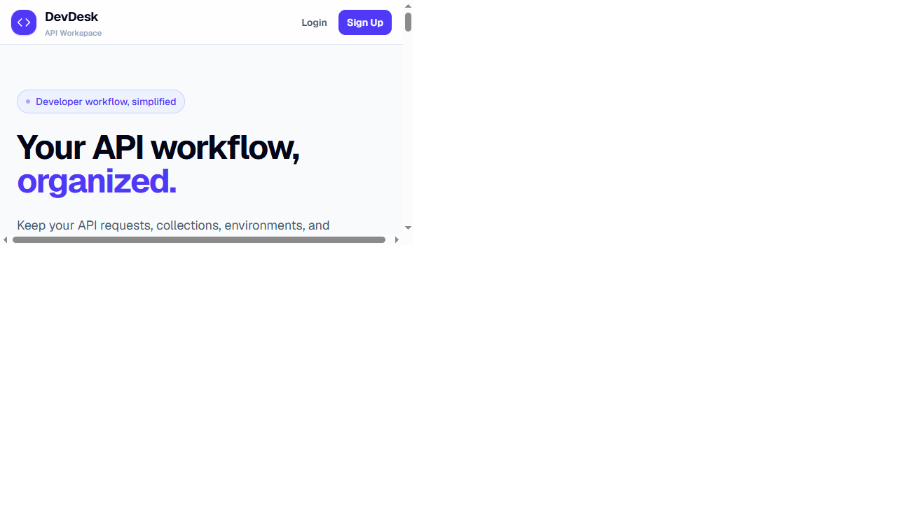

# DevDesk

DevDesk is a small API workspace for organizing HTTP requests, collections, and environment variables. Requests can use `{{variable}}` placeholders and be sent from the browser, with the response status and body shown in the app.



## Features

- Create workspaces, collections, and saved API requests.
- Store headers, query parameters, request bodies, and request notes.
- Define environment variables and select an active environment per workspace.
- Substitute `{{variable}}` values in a request before sending it.
- Send requests directly from the browser and inspect the response.
- Sign in and persist application data with Supabase Auth and Postgres.

## Requirements

- Node.js 22 or newer
- pnpm 10
- A Supabase project with the database schema and migrations applied

## Local setup

```sh
pnpm install
```

Copy `.env.example` to `.env`, then set the Supabase project URL and anon key:

```dotenv
VITE_SUPABASE_URL=https://your-project-ref.supabase.co
VITE_SUPABASE_ANON_KEY=your-supabase-anon-key
```

Start the development server:

```sh
pnpm dev
```

## Sending requests

Requests are sent directly from the browser. The target API must allow the app's origin through CORS; APIs that do not allow browser requests cannot be called this way. CORS can also limit which response headers the browser lets the app read.

Environment values used in a request are available in the browser's developer tools and network panel. Use test credentials only; do not store production secrets in the app.

## Database migrations

The clean-install schema and owner-scoped RLS policies are versioned in `supabase/migrations`. The older manual upgrade scripts are preserved in `supabase/legacy-migrations` for reference and should not be run on a fresh project. To apply migrations to a linked Supabase project, first inspect the pending changes with `supabase db push --dry-run --remote`, then apply them with `supabase db push --remote`. The first CLI push initializes Supabase's migration history table. Do not apply migrations to a database until the target project and dry-run output have been checked.

## Quality checks

```sh
pnpm lint
pnpm typecheck
pnpm test
pnpm build
```

GitHub Actions runs these four checks for pushes and pull requests.

## License

MIT. See [LICENSE](./LICENSE).
