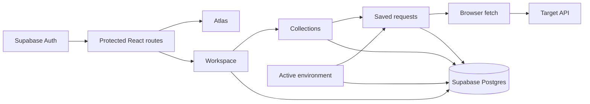

# DevDesk

<p>
  <a href="https://devdesk-omega.vercel.app/">
    
  </a>
  <a href="https://github.com/Ali-jalili/Devdesk/actions/workflows/ci.yml">
    
  </a>
</p>

DevDesk is a browser-based API workspace for organizing, documenting, and executing HTTP requests. It combines workspace-scoped collections and environments with a visual API map and an in-browser request runner.

## Product capabilities

- **Organize API work:** Group saved requests into collections inside workspaces, with descriptions and notes for project context.
- **Build requests:** Configure `GET`, `HEAD`, `POST`, `PUT`, `PATCH`, and `DELETE` requests with URLs, query parameters, headers, and JSON or plain-text bodies.
- **Manage environments:** Keep variables in workspace environments, choose the active environment, and use `{{variable}}` placeholders across request fields.
- **Import cURL:** Paste a cURL command or URL in Atlas to prefill a new request with its method, URL, headers, query parameters, and body.
- **Map an API:** Use Atlas to browse collections and endpoints, review recently added requests, and find undocumented requests or empty collections.
- **Inspect responses:** View response status, readable headers, body, elapsed time, and size. The response stream is capped at 1 MB to bound memory use in the UI.
- **Protect user data:** Sign in through Supabase Auth. Row-level security policies scope workspace data to its owner.

## Engineering highlights

- **A testable request-preparation boundary:** [`prepareRequest`](src/features/requests/requestExecution.ts) resolves active-environment variables, reports undefined names before network activity, validates the resolved HTTP(S) URL, applies query parameters, and omits bodies for `GET` and `HEAD`.
- **One URL rule across entry points:** [`isValidRequestUrl`](src/utils/requestUrl.ts) validates normal URLs and URLs that contain environment placeholders. The same rule is used by request forms and cURL parsing.
- **Bounded response reading:** The response body is consumed as a stream, stopped at 1 MB, and canceled after the limit rather than reading an unbounded body into memory.
- **Workspace-aware cache cleanup:** On successful workspace deletion, related queries are canceled and removed, and the persisted active-workspace selection moves to another workspace or is cleared. See [`useDeleteWorkspace`](src/features/workspaces/hooks/useDeleteWorkspace.ts) and [`workspaceCache`](src/features/workspaces/workspaceCache.ts).
- **Database-enforced ownership:** RLS policies cover workspaces, collections, environments, environment variables, and requests; foreign keys cascade workspace and collection deletions through their child data. See the [base schema](supabase/migrations/20261112000000_base_schema.sql) and [owner policies](supabase/migrations/20261112000100_owner_rls.sql).

## Architecture

The application uses feature-oriented React modules, route-level lazy loading, and TanStack Query for server-state caching. Supabase stores the authenticated user's workspaces and related API data. Requests are executed from the browser against the target API.



### Main source areas

```text
src/
├── app/                 # Router, layouts, authentication context
├── components/          # Shared application UI
├── features/
│   ├── atlas/           # API map, overview panels, cURL import
│   ├── collection/      # Collection management
│   ├── environments/    # Environments and variables
│   ├── requests/        # Request forms, persistence, execution, response view
│   └── workspaces/      # Workspace selection and management
├── page/                # Public pages and route error handling
├── lib/                 # Supabase client and shared library setup
└── utils/               # URL, variable, cURL, and data helpers
```

### Data relationships

```text
User
└── Workspaces
    ├── Collections
    │   └── Requests
    └── Environments
        └── Environment variables
```

Requests belong to collections, and collections and environments belong to a workspace. Row-level security checks ownership through those parent relationships, so data access is enforced by Postgres as well as the client UI.

## Technology

| Area | Tools |
| --- | --- |
| UI | React 19, TypeScript, Tailwind CSS 4 |
| Routing and data | React Router 7, TanStack Query 5 |
| Forms | React Hook Form, Zod |
| Backend | Supabase Auth, Postgres, and row-level security |
| Build and tests | Vite 8, Vitest 5, Testing Library, ESLint |

## Requirements

- Node.js 22 or newer
- pnpm 10
- A Supabase project with the migrations in `supabase/migrations` applied

## Run locally

```sh
pnpm install
```

Copy `.env.example` to `.env` and configure your Supabase project:

```dotenv
VITE_SUPABASE_URL=https://your-project-ref.supabase.co
VITE_SUPABASE_ANON_KEY=your-supabase-anon-key
```

For PowerShell, the copy command is:

```powershell
Copy-Item .env.example .env
```

Start the development server:

```sh
pnpm dev
```

Vite serves the app at `http://127.0.0.1:5173` by default. The configured port is strict, so the server exits if that port is already in use.

## Supabase migrations

The clean-install schema and owner-scoped RLS policies are maintained in `supabase/migrations`. The scripts in `supabase/legacy-migrations` are retained for reference and are not the clean-install path.

With the Supabase CLI installed, authenticated, and linked to the intended project, inspect the pending migration plan before applying it:

```sh
supabase db push --dry-run --remote
supabase db push --remote
```

Check the linked project and dry-run output before changing a remote database. The migrations establish workspace ownership and cascading relationships for environments, collections, variables, and requests.

## Quality checks

```sh
pnpm lint
pnpm typecheck
pnpm test
pnpm build
```

GitHub Actions runs lint, type checking, unit/component tests, and a production build for pushes and pull requests. Tests cover URL validation, variable interpolation and request preparation, cURL parsing, form validation, workspace selection/cache behavior, Supabase service behavior, and key UI flows. `pnpm preview` serves the production build locally after `pnpm build`.

## Request execution limits

Requests run in the user's browser. The target API must allow the DevDesk origin through CORS; browser CORS rules may also restrict which response headers are readable. This is a browser-based request runner, not a server-side proxy.

## Security

The Supabase anon key is used by the browser client and is not a substitute for access control; database access relies on the owner-scoped RLS policies. Environment values and request contents can be inspected in DevTools and the browser network panel. Use test or otherwise non-sensitive values in browser requests, and never put a Supabase service-role key or production secret in a `VITE_` variable.

## 👨‍💻 Author

**Ali Jalili** — Frontend Developer

- **Portfolio:** [ali-jalili-dev.vercel.app](https://ali-jalili-dev.vercel.app/)
- **LinkedIn:** [Ali Jalili](https://www.linkedin.com/in/ali--jalili/)
- **Email:** [ali.jalili.dev@gmail.com](mailto:ali.jalili.dev@gmail.com)
